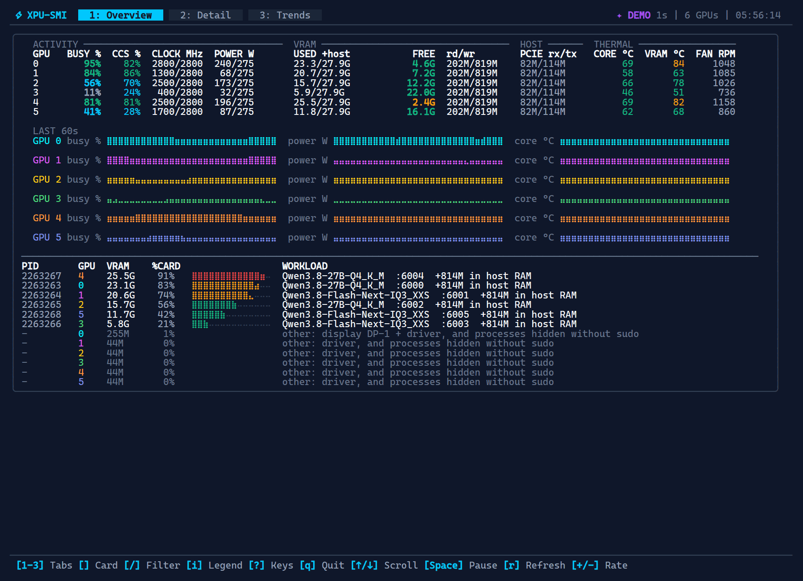

# xpu-smi-tui

[](https://github.com/travlytle/xpu-smi-tui/actions/workflows/ci.yml)
[](https://github.com/travlytle/xpu-smi-tui/releases/latest)
[](https://github.com/travlytle/xpu-smi-tui/releases)
[](go.mod)
[](LICENSE)

Terminal dashboard and Prometheus exporter for Intel Arc GPUs. Reads Level Zero Sysman, sysfs and fdinfo directly; `xpu-smi` is not required.



## Install

Requires Linux x86_64 and the Level Zero runtime (`libze1`, `libze-intel-gpu1`).

**Release:** download the `.deb` or tarball from [Releases](https://github.com/travlytle/xpu-smi-tui/releases).

```bash
sudo apt install ./xpu-smi-tui_*.deb
```

**Go** (1.26+, needs `gcc`):

```bash
go install github.com/travlytle/xpu-smi-tui@latest
go install github.com/travlytle/xpu-smi-tui/cmd/xpu-exporter@latest
```

**Source:** `make build`, or `./install.sh` to install with shell completions.

Exact A-series VRAM and accurate PCIe throughput need `CAP_PERFMON` (the .deb and `sudo ./install.sh --system` grant it):

```bash
sudo setcap cap_perfmon+ep "$(command -v xpu-smi-tui)"
```

## Usage

```
-i, --interval N     refresh interval in seconds (default 1)
--device N           card to focus at start (-1 = all)
-d, --demo           simulated data
--demo-cards N       simulated cards, 1-16 (default 6)
--gpu-order LIST     PCI addresses in numbering order (or $XPU_GPU_ORDER)
--idle-poll SECS     sample interval for a suspended card; 0 never, off always (default 30)
--theme NAME         default, dracula, nord, gruvbox, catppuccin-mocha, catppuccin-latte,
                     tokyo-night, solarized-dark, one-dark, monokai, rose-pine (or $XPU_THEME)
-v, --version
```

Press `?` for keys, `i` for what each reading means, `t` to cycle themes, `v` to cycle the Trends style (stripes, lines, per card) and `s` for braille or block graphs. Run with `sudo` to name other users' processes.

## Exporter

```bash
xpu-exporter --listen :9835
```

The .deb installs it with a systemd unit: `sudo systemctl enable --now xpu-exporter@$USER` (unit file: `packaging/xpu-exporter@.service`). Grafana dashboard: `packaging/grafana/xpu-gpu.json`, also in `/usr/share/doc/xpu-smi-tui/`.

## License

MIT. Includes Intel's MIT-licensed Level Zero headers. Not affiliated with Intel.
